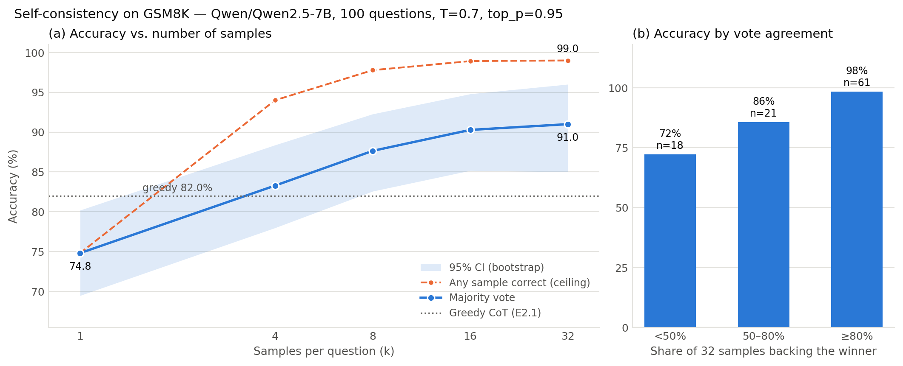

# E2.2-B — Self-Consistency on the Base Model: Results

| | |
|---|---|
| **Stage** | 2 — Reasoning Methods in Language Models (ablation of [E2.2](E2.2_self_consistency.md)) |
| **Model** | `Qwen/Qwen2.5-7B` (base, no instruction tuning; bfloat16) |
| **Dataset** | GSM8K test split, the same 100 questions as [E2.1-B](E2.1_base_model.md) (seed 42) |
| **Command** | `python e2_2_self_consistency.py --model base --n_eval 100 --greedy_ref outputs/e2_1_results_20261101_1601_base.json` |
| **Result file** | `outputs/e2_2_results_20261101_1810_base.json` (+ `_scaling.png/.pdf`, `_table.md`) |
| **Status** | ✅ Complete. Clean scaling curve; gains about 4× larger than on the Instruct model |

---

## 1. Question

Wang et al. (2023) report the largest self-consistency gains when a single reasoning chain is
only moderately reliable. On the Instruct model (90% single-chain accuracy) the gain was small
(+4.2 pp). Does the weaker base model gain more, and how much of the base–Instruct gap can
sampling close?

## 2. Setup

Identical to [E2.2](E2.2_self_consistency.md) except for the model and prompt:

- **Prompt:** the E2.1-B zero-shot CoT prompt, `Q: {q}\nA: Let's think step by step.`
  (plain text, no chat template, no system prompt).
- **Stopping:** at `\nQ:`, `\nQuestion:` or `\n[Question]`, as in E2.1-B.
- **Answer per sample:** trigger phrase ("The answer is …") or last number. There is no Kojima
  second stage, which would double the cost. E2.1-B showed that the two rules agree on all 100
  questions, so the greedy comparison is like-for-like.
- **Sampling:** T = 0.7, top_p = 0.95, `top_k=0`, `repetition_penalty=1.0`, 512 new tokens,
  32 samples per question. Smaller k evaluated over 100 random subsets.

## 3. Results

### 3.1 Accuracy vs. number of samples

| k | Majority vote | 95% CI | Any sample correct | Gain over k=1 | Gap to ceiling |
|---:|---:|---:|---:|---:|---:|
| 1 | 74.8% | [69.5, 80.2] | 74.8% | +0.0 pp | 0.0 pp |
| 4 | 83.3% | [78.0, 88.4] | 94.0% | +8.5 pp | 10.7 pp |
| 8 | 87.7% | [82.6, 92.3] | 97.8% | +12.8 pp | 10.1 pp |
| 16 | 90.3% | [85.2, 94.8] | 98.9% | +15.5 pp | 8.6 pp |
| 32 | **91.0%** | [85.0, 96.0] | **99.0%** | **+16.2 pp** | 8.0 pp |

**Against greedy CoT (E2.1-B):** greedy 82.0% → SC@32 91.0%, **+9.0 pp**. SC alone is right
on 11 questions, greedy alone on 2; exact McNemar **p = 0.0225**. (The 11/2 split happens to
match the Instruct run exactly; the questions involved are different.)

### 3.2 Curve checks

| Check | Result | |
|---|---|---|
| Accuracy never falls as k grows | 74.8 → 83.3 → 87.7 → 90.3 → 91.0 | ✅ |
| Gain per doubling of k shrinks | +4.24 → +4.36 → +2.63 → +0.72 pp per doubling | ✅ (flat over 1→8, then falling) |
| SC@32 beats greedy at p < 0.05 | p = 0.0225 | ✅ |
| CI at k=32 lies fully above the CI at k=1 | 85.0 > 80.2 | ✅ (failed on Instruct) |

### 3.3 Sample statistics

| | Base | Instruct (E2.2) |
|---|---:|---:|
| Samples | 3,200 (100 × 32) | 9,600 (300 × 32) |
| Extraction failures | 0 | 0 |
| Truncated at 512 tokens | 5 (0.2%) | 134 (1.4%) |
| Tokens per sample (mean / median) | **98.9** / 92 | 257.1 / 245 |
| Distinct answers per question | **4.62** | 2.05 |

## 4. Marginal accuracy per unit of compute

At 98.9 tokens per sample, a question costs about **99 × k generated tokens**.

| Step | Extra samples | Extra tokens / question | Gain | pp per extra sample | pp per doubling | pp per 1k extra tokens |
|---|---:|---:|---:|---:|---:|---:|
| 1 → 4 | 3 | ~297 | +8.48 | **2.83** | 4.24 | **28.6** |
| 4 → 8 | 4 | ~396 | +4.36 | **1.09** | 4.36 | **11.0** |
| 8 → 16 | 8 | ~791 | +2.63 | **0.33** | 2.63 | **3.3** |
| 16 → 32 | 16 | ~1,582 | +0.72 | **0.045** | 0.72 | **0.46** |

The curve keeps climbing longer than on the Instruct model. Gains per doubling hold steady at
about 4.3 pp up to k = 8, where the Instruct curve was already flattening. **k = 16 captures 96%
of the total gain** (Instruct: k = 8 captured 87%).

## 5. Interpretation

### 5.1 Self-consistency helps the weaker model much more

| | Base | Instruct |
|---|---:|---:|
| Single sample (k = 1) | 74.8% | 89.1% |
| Greedy CoT | 82.0% | 90.3% |
| SC@32 | 91.0% | 93.3% |
| Gain over k = 1 | **+16.2 pp** | +4.2 pp |
| Gain over greedy | **+9.0 pp** | +3.0 pp |

This reproduces the key qualitative claim of Wang et al.: the gain grows as single-chain
reliability falls. The reason is visible in the sample statistics: the base model produces more
varied answers (4.62 distinct answers per question vs 2.05), but its errors are spread out while
correct chains agree. Voting filters out that scatter.

**Sampling costs the base model more.** A single sampled chain is **7.2 pp below** greedy
(Instruct: −1.2 pp), so voting needs about 3–4 samples just to match greedy. It clearly passes
greedy from k = 4 (83.3%).

### 5.2 Sampling closes most of the base–Instruct gap, but not cheaply

The gap between base and Instruct shrinks from 8.3 pp (greedy) to **2.3 pp at k = 32**. Measured
in tokens, though, the Instruct model is still far more efficient. One Instruct chain (~257
tokens, 89–90%) does about as well as **16 base samples** (~1,580 tokens, 90.3%). Instruction
tuning buys roughly a 6× saving in inference compute at this accuracy level.

The comparison uses different question sets (100 vs 300). The base questions are the first 100
of the Instruct set, so the direction is reliable, but the exact gap is not.

### 5.3 Agreement is still a reliable confidence signal, and a more useful one

| Agreement | Questions | Accuracy | Errors |
|---|---:|---:|---:|
| ≥ 80% | 61 | 98.4% | 1 |
| 50–80% | 21 | 85.7% | 3 |
| < 50% | 18 | 72.2% | 5 |
| **All** | **100** | **91.0%** | **9** |

**8 of 9 errors are in the 39% of questions where agreement is below 80%**, while high-agreement
answers are 98.4% correct. Unlike the Instruct run, accuracy now drops steadily from bin to bin.
On the base model, far more questions are contested (39% vs 13%), so an adaptive budget would
have more to work with: stop early on the 61% of questions that agree quickly, and spend more
samples on the rest (thesis direction D6).

### 5.4 A larger selection gap for E2.4

At k = 32, a correct answer is among the samples for 99.0% of questions, but voting picks it
for 91.0%. The **8.0 pp gap** is almost twice the Instruct gap (4.7 pp). A verifier that scores
reasoning instead of counting answers therefore has more room to show a benefit on the base
model. That makes the base model the more informative setting for E2.4.

## 6. Limitations

- n = 100: bootstrap intervals are about ±5.5 pp. The paired test against greedy is significant,
  but adjacent k values (16 vs 32) cannot be told apart.
- One temperature (0.7). The base model's single-sample penalty (−7.2 pp) suggests T = 0.7 is
  relatively noisy for it; a lower temperature might raise k = 1 but shrink the diversity that
  voting relies on.
- The 5 truncated samples (0.2%) vote with their last number. With 32 votes per question they
  cannot change a majority.
- The k < 32 accuracies are expectations over subsets of one pool of 32 samples, not
  independent runs.

## 7. What this result feeds into

- **E2.4:** run best-of-n reranking on the base model as well as the Instruct model. The 8 pp
  selection gap gives a verifier room to show a difference.
- **Thesis direction D6 (adaptive compute):** agreement separates easy from contested questions
  more sharply on the weaker model.
- **Stage 3:** test-time scaling helps most where single chains are unreliable. Whether that
  carries over to perception-bound visual questions is an open question, because samples that
  share the same misreading of an image will agree on the same wrong answer.
