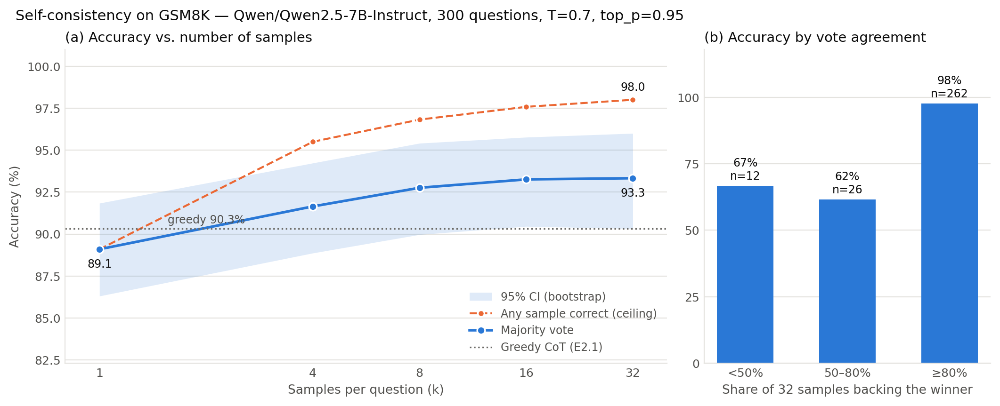

# E2.2 — Self-Consistency: Results

| | |
|---|---|
| **Stage** | 2 — Reasoning Methods in Language Models |
| **Model** | `Qwen/Qwen2.5-7B-Instruct` (bfloat16) |
| **Dataset** | GSM8K test split, the same 300 questions as E2.1 (seed 42) |
| **Script** | [`e2_2_self_consistency.py`](../e2_2_self_consistency.py), plotting in [`plot_e2_2.py`](../plot_e2_2.py) |
| **Result files** | `outputs/e2_2_results_20261031_0022.json`, `…_scaling.png/.pdf`, `…_table.md` |
| **Greedy reference** | `outputs/e2_1_results_20261030_1952.json` (E2.1 zero-shot CoT) |
| **Status** | ✅ Success criterion met |

---

## 1. Success criterion (from the roadmap)

> *Add majority voting over k samples for k in {1, 4, 8, 16, 32}. Plot accuracy against compute.*
>
> **Success criterion:** *A clean scaling curve. You can state the marginal accuracy per unit
> of compute.*

| Part of the criterion | Evidence | Verdict |
|---|---|---|
| Majority voting for k ∈ {1, 4, 8, 16, 32} | 32 samples per question (9,600 in total); every k evaluated | ✅ |
| Accuracy plotted against compute | Figure below; k is on a log₂ axis, and compute is proportional to k (§4) | ✅ |
| **Clean** scaling curve | Accuracy never drops as k grows, gains shrink with every doubling, and the curve saturates (§3.2) | ✅ |
| Marginal accuracy per unit of compute stated | Table in §4: pp per extra sample, per doubling, and per 1k generated tokens | ✅ |

The result also covers one Stage 2 gate-check item: *"I have my own measured test-time scaling
curve and know its shape."*

---

## 2. Setup

- **Prompt:** identical to E2.1 `zero_shot_cot` (same system prompt plus "Let's think step by
  step."). The only change from the E2.1 greedy baseline is **sampling plus voting**.
- **Sampling:** temperature 0.7, top_p 0.95, `top_k=0` and `repetition_penalty=1.0` set
  explicitly to disable Qwen2.5's hidden defaults (`top_k=20`, `1.05`). `max_new_tokens=512`.
- **Sample reuse:** 32 samples are drawn once per question. The accuracy at a smaller k is the
  **expected** majority-vote accuracy over 100 random k-subsets of those 32 samples, which
  gives a smoother curve than using only the first k samples.
- **Voting:** answers are compared numerically after canonicalisation (`"18.0"` = `"18"`).
  Samples without a number do not vote, and ties go to the answer seen first.
- **Statistics:** 95% bootstrap CI over questions (1,000 resamples). Exact McNemar test of
  SC@32 against greedy CoT on the same questions.

---

## 3. Results

### 3.1 Accuracy vs. number of samples

| k | Majority vote | 95% CI | Any sample correct (ceiling) | Gain over k=1 | Gap to ceiling |
|---:|---:|---:|---:|---:|---:|
| 1 | 89.1% | [86.3, 91.8] | 89.1% | +0.0 pp | 0.0 pp |
| 4 | 91.7% | [88.9, 94.2] | 95.5% | +2.6 pp | 3.9 pp |
| 8 | 92.8% | [90.0, 95.4] | 96.8% | +3.7 pp | 4.1 pp |
| 16 | 93.3% | [90.5, 95.8] | 97.6% | +4.2 pp | 4.3 pp |
| 32 | **93.3%** | [90.3, 96.0] | **98.0%** | +4.2 pp | 4.7 pp |

**Against greedy CoT (E2.1):** greedy 90.3% → SC@32 93.3%, **+3.0 pp**.
Of the 13 questions where the two methods disagree, SC alone is right on **11** and greedy
alone on **2**. Exact McNemar **p = 0.0225**, so the improvement is significant at α = 0.05.

### 3.2 Why the curve counts as "clean"

The checks below are printed by [`plot_e2_2.py`](../plot_e2_2.py):

| Check | Result | |
|---|---|---|
| Accuracy never falls by more than 0.5 pp as k grows | 89.1 → 91.7 → 92.8 → 93.3 → 93.3 (it never falls at all) | ✅ |
| Gain per doubling of k shrinks (diminishing returns) | +1.28 → +1.11 → +0.50 → +0.07 pp per doubling | ✅ |
| SC@32 beats greedy CoT at p < 0.05 | p = 0.0225 | ✅ |
| CI at k=32 lies fully above the CI at k=1 | ✗: 90.3 (lower bound at k=32) < 91.8 (upper bound at k=1) | ⚠️ |

The last check fails, and that is expected. Separate (marginal) bootstrap intervals for two
conditions measured on the **same** questions are the wrong tool for comparing them, because
they ignore that the two conditions succeed and fail on mostly the same items. The paired
McNemar test is the right tool, and it is significant. The interval check is kept in the
script as a conservative sanity check, not as the criterion.

### 3.3 Sample statistics

| | |
|---|---|
| Samples generated | 9,600 (300 × 32) |
| Extraction failures | **0** |
| Truncated at 512 tokens | 134 (1.4%) |
| Tokens per sample | mean 257.1, median 245 |
| Distinct answers per question (out of 32) | mean 2.05 |

---

## 4. Marginal accuracy per unit of compute

Each sample has the same expected length, independent of k, so generation cost grows
**linearly in k**: about **257 × k generated tokens per question**. The k axis on the plot is
therefore a compute axis.

| Step | Extra samples | Extra tokens / question | Accuracy gain | **pp per extra sample** | pp per doubling of k | **pp per 1k extra tokens** |
|---|---:|---:|---:|---:|---:|---:|
| 1 → 4 | 3 | ~771 | +2.55 | **0.85** | 1.28 | **3.31** |
| 4 → 8 | 4 | ~1,028 | +1.11 | **0.28** | 1.11 | **1.08** |
| 8 → 16 | 8 | ~2,057 | +0.50 | **0.06** | 0.50 | **0.24** |
| 16 → 32 | 16 | ~4,114 | +0.07 | **0.004** | 0.07 | **0.02** |

**In one sentence:** each additional sample is worth about 0.85 pp at small k, falling by
roughly 200× to 0.004 pp by k = 16–32. Almost all of the benefit (+3.7 of the +4.2 pp, i.e.
87%) is captured by **k = 8**, at a quarter of the k = 32 cost.

**Shape of the curve:** accuracy grows roughly logarithmically in k up to k ≈ 8 and is flat by
k ≈ 16. The plateau (93.3%) sits **4.7 pp below** the any-correct ceiling (98.0%). More samples
keep raising the ceiling but no longer move the majority vote.

**Practical operating points:**

| Goal | Choice | Cost vs. greedy |
|---|---|---|
| Cheapest improvement over greedy | k = 4 (91.7%, +1.3 pp over greedy, not significant alone) | ~4× |
| Best accuracy per compute | **k = 8** (92.8%) | ~8× |
| Maximum accuracy | k = 16 (93.3%); k = 32 adds nothing | ~16× |

---

## 5. Interpretation

### 5.1 One sample costs accuracy, voting buys it back

A single sampled chain at T = 0.7 (89.1%) is **1.2 pp worse** than the greedy chain (90.3%).
Sampling adds diversity, and part of that diversity is error. Self-consistency only pays off
because the errors are **spread across different wrong answers** while correct chains agree on
one answer: on average there are only 2.05 distinct answers per question. Voting needs about
2–3 samples just to break even with greedy and passes it clearly from k = 4.

### 5.2 Agreement is a reliable confidence signal

Panel (b) groups questions by the share of the 32 samples that back the winning answer:

| Agreement | Questions | Accuracy | Errors |
|---|---:|---:|---:|
| ≥ 80% | 262 (87%) | 97.7% | 6 |
| 50–80% | 26 (9%) | 61.5% | 10 |
| < 50% | 12 (4%) | 66.7% | 4 |
| **All** | **300** | **93.3%** | **20** |

**70% of all errors (14 of 20) come from the 13% of questions where agreement is below 80%.**
The model "knows when it doesn't know": high agreement almost always means a correct answer.
Two consequences:

- **Selective prediction:** abstaining or escalating on the 38 low-agreement questions would
  leave 97.7% accuracy on the remaining 87%.
- **Adaptive compute:** most questions reach high agreement quickly. Stopping sampling early
  once agreement is clear, and spending the budget on contested questions, should give the
  k = 32 accuracy at a fraction of the cost. This is the text-only version of candidate thesis
  direction **D6 (adaptive reasoning budgets)**.

The two low-agreement bins are too small (n = 26 and n = 12) to rank against each other. Their
apparent reversal (61.5% vs 66.7%) is noise.

### 5.3 The selection gap motivates E2.4

At k = 32 a correct answer is **present** among the samples for 98.0% of questions, but majority
voting **picks** it for only 93.3%. The 4.7 pp difference (14 questions) is lost because the
correct answer is a minority among the samples. Voting cannot fix this, since it only counts
answers. A verifier that scores the *reasoning* could. This is the headroom E2.4 (outcome vs.
process reward models, best-of-n) is designed to measure.

### 5.4 Comparison with the original paper

Wang et al. (2023) report much larger gains on GSM8K (for example +17.9 pp for PaLM 540B,
56.5% → 74.4%). The smaller gain here (+4.2 pp over k = 1, +3.0 pp over greedy) is consistent
with that paper's own trend: gains are largest when single-chain accuracy is moderate. At
about 90% baseline accuracy only 10% of questions remain to fix, and the any-correct ceiling
shows that about 2% of them are never solved by any sample. The qualitative finding, a
monotone increase that saturates with diminishing returns, is reproduced.

---

## 6. Limitations

- **One model, one temperature (0.7), one seed.** The curve's shape, especially the plateau
  height, depends on temperature. Higher T means more diversity, which raises the ceiling but
  also adds noise.
- **n = 300:** the bootstrap intervals are about ±2.8 pp wide. The paired test against greedy
  is significant, but the differences between adjacent k values (for example 16 vs 32) are not
  individually resolvable.
- **Truncated samples (1.4%)** still vote, using the last number in the text, which is usually
  an intermediate value. With an average of only 0.45 truncated samples per question, they are
  very unlikely to change a majority, but they bias the any-correct rate slightly downward.
- **Compute is measured in generated tokens.** Prompt prefill is shared across the 32 samples
  of a question and not counted. Wall-clock time depends on batching (32 samples generated in
  parallel) and Colab disconnects, so it is not reported as a cost measure.
- The k < 32 accuracies are expectations over resampled subsets of one pool of 32 samples, not
  independent runs. This lowers variance between adjacent k values, so the curve looks
  smoother than independent runs would.

## 7. What this result feeds into

- **E2.4 (verifier study):** best-of-n reranking is evaluated at the same n ∈ {1, 4, 8, 16, 32}.
  Majority voting (93.3% at 32) is the baseline a verifier must beat. The any-correct curve
  (98.0%) is the upper bound for any selector.
- **Stage 3 and Stage 5:** the same scaling curve on a VLM will show whether test-time scaling
  helps on perception-bound items, where all samples may share the same misreading of the image
  and voting cannot help.
- **Thesis direction D6:** the agreement-vs-accuracy result is first evidence that a cheap
  signal (sample agreement) can drive adaptive compute allocation.
