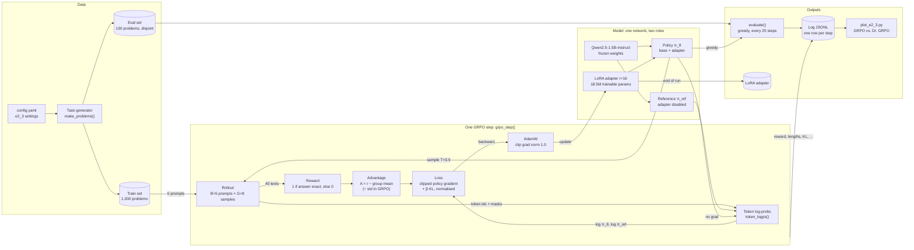

# E2.3 — Block Diagram: Components and Data Flow

Key points:

- **One network plays both roles.** The policy is the base model with the LoRA adapter; the
  reference is the *same* weights with the adapter switched off (`model.disable_adapter()`).
  This removes the need for a second 3 GB copy of the model, and the reference is exactly the
  starting point of training, because the adapter's B matrices start at zero.
- **Only the adapter learns.** 18.5M of 1.56B parameters (1.18%) receive gradients; the base
  weights are frozen.
- **Everything the success criterion needs is logged per step**: reward (does it increase?)
  and the lengths of correct vs. incorrect answers (is there a length bias?).

← Back to [E2.3 implementation](E2.3_grpo_implementation.md)
