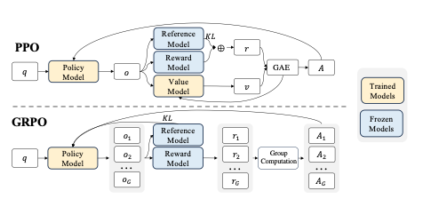
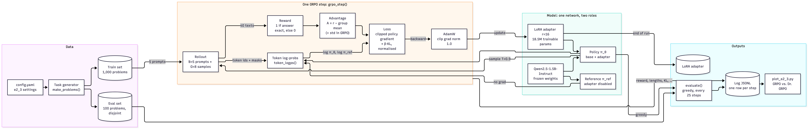
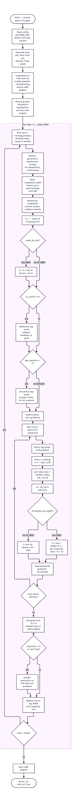
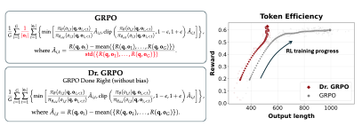

# E2.3 — How the GRPO Implementation Works

| | |
|---|---|
| **Script** | [`e2_3_grpo_by_hand.py`](../e2_3_grpo_by_hand.py) (168 lines of code), settings in `e2_3` of [`config.yaml`](../config.yaml) |
| **Papers** | Shao et al. (2024), DeepSeekMath, arXiv:2402.03300 (GRPO) · Liu et al. (2025), arXiv:2503.20783 (Dr. GRPO) |
| **Variants** | `--variant grpo` and `--variant dr_grpo`, identical except for two switches (§3.6) |

This page explains the implementation: the components and how data flows between them
(§1), the training loop step by step (§2), and the maths behind each step with links to the
code (§3). Results are on a separate page: [E2.3 results](E2.3_grpo_results.md).

**GRPO in one paragraph.** For each question, sample a *group* of G answers from the current
model and score each with a verifiable reward. An answer's *advantage* is how much better it
scored than the group average, so the group acts as its own baseline and no value network is
needed. The model is then nudged to make above-average answers more likely and below-average
ones less likely, with a clip on how far one update can move, and a KL penalty that keeps the
model close to a frozen reference copy.



*PPO (top) requires a reward model and a value model in addition to the policy. GRPO (bottom)
drops the value model: instead of a learned baseline, it uses the group mean reward as a
self-contained baseline, so only the policy and a frozen reference are needed.*

---

## 1. Block diagram: components and data flow



*Mermaid source: [E2.3_grpo_block_diagram.md](E2.3_grpo_block_diagram.md)*

Key points:

- **One network plays both roles.** The policy is the base model with the LoRA adapter; the
  reference is the *same* weights with the adapter switched off (`model.disable_adapter()`).
  This removes the need for a second 3 GB copy of the model, and the reference is exactly the
  starting point of training, because the adapter's B matrices start at zero.
- **Only the adapter learns.** 18.5M of 1.56B parameters (1.18%) receive gradients; the base
  weights are frozen.
- **Everything the success criterion needs is logged per step**: reward (does it increase?)
  and the lengths of correct vs. incorrect answers (is there a length bias?).

---

## 2. Flow chart: the training loop



*Mermaid source: [E2.3_grpo_training_loop.md](E2.3_grpo_training_loop.md)*

With the default `ppo_epochs: 1`, the "for each epoch" loop runs once, so the flow is:
one rollout → one gradient step. With μ > 1 the same rollouts would be reused for μ updates,
which is where the old-policy log-probs and clipping start to matter (§3.4).

---

## 3. Step by step, with the code

### 3.1 Task and reward — [`make_problems`](../e2_3_grpo_by_hand.py#L60), [`reward`](../e2_3_grpo_by_hand.py#L75)

Problems are random integer expressions with 4 operands ≤ 99 and the operators `+ - *`, e.g.
`Compute: 37 * 14 - 85 * 6 + 9`. The answer is computed with Python's `eval`, which is safe
here because the expression is built only from generated integers and three operators.

- The **eval set is generated first** with seed + 1, and its expressions are excluded from the
  train set, so the two never overlap ([L72–73](../e2_3_grpo_by_hand.py#L72)).
- The **reward is binary**: the shared `extract_pred` from E2.1/E2.2 pulls the number after
  "The answer is" (or the last number), and `is_correct` compares it numerically. There is no
  partial credit and no format reward, which keeps the reward strictly verifiable.

### 3.2 Rollout — [`rollout`](../e2_3_grpo_by_hand.py#L106)

The 8 prompts are rendered with the chat template (system prompt + `Compute: …`) and batched
with **left padding**, so every prompt ends at the same position and generation starts right
after it. `generate(num_return_sequences=8)` returns 64 sequences ordered prompt by prompt:
rows 0–7 belong to prompt 0, rows 8–15 to prompt 1, and so on. That ordering is what lets
`rewards.view(B, G)` form the groups later.

Sampling settings are set explicitly (T = 0.9, top_p = 1.0, top_k off, repetition penalty
1.0), because Qwen's `generation_config.json` would otherwise add its own defaults.

**Completion mask** ([L116–119](../e2_3_grpo_by_hand.py#L116)). After the first EOS token,
generation pads. The mask keeps every completion token *up to and including* the first EOS,
so the model is also trained on when to stop. A completion with no EOS within 256 tokens is
counted as truncated and keeps all its tokens.

### 3.3 Advantages — [L136–141](../e2_3_grpo_by_hand.py#L136)

For the 8 rewards $r_1 … r_8$ of one prompt:

$$A_i = r_i - \mathrm{mean}(r_1, …, r_8) \qquad \text{GRPO additionally divides by } \mathrm{std}(r_1, …, r_8) + 10^{-4}$$

Every token of response $i$ gets the same advantage $A_i$. When all 8 answers score the same
(all right or all wrong), every $A_i = 0$ and the group contributes no policy gradient; the log
reports the share of such groups as `zero_signal_groups`.

### 3.4 Log-probabilities and the ratio — [`token_logps`](../e2_3_grpo_by_hand.py#L126), [L156](../e2_3_grpo_by_hand.py#L156)

`token_logps` runs the model over prompt + completion and returns $\log \pi(o_t \mid q, o_{<t})$
for every completion token. Two details matter:

- **Position ids skip the left padding** (`attn.cumsum(-1) - 1`). Without this, a padded prompt
  would get shifted positions in the training forward pass, while `generate()` used the
  correct ones, so the log-probs would not match the sampled tokens.
- **Log-softmax runs in float32** over the 151,936-token vocabulary, for numerical accuracy of
  small probability differences.

The probability ratio is $\rho_t = \exp(\log \pi_\theta - \log \pi_{\text{old}})$. With the
default μ = 1 the "old" policy *is* the current one, so the code uses
`logp.detach()`: $\rho \equiv 1$ in value, but its gradient is still
$\nabla \log \pi_\theta$. In that case the clip never triggers, and the update reduces to a
policy gradient with a group baseline. Clipping only becomes active with μ > 1.

### 3.5 Per-token loss: clipped policy gradient + KL — [L157–163](../e2_3_grpo_by_hand.py#L157)

$$\ell_{i,t} = -\min\!\big(\rho_{i,t} A_i,\; \mathrm{clip}(\rho_{i,t}, 1-\varepsilon, 1+\varepsilon)\, A_i\big) \;+\; \beta\, \mathrm{KL}_{i,t}$$

with ε = 0.2 and β = 0.01. The KL term uses the **k3 estimator** from DeepSeekMath, with
$d = \log \pi_{\text{ref}} - \log \pi_\theta$:

$$\mathrm{KL}_{i,t} = e^{d} - d - 1 \;\ge\; 0$$

It is an unbiased, always non-negative per-token estimate of $\mathrm{KL}(\pi_\theta \,\|\, \pi_{\text{ref}})$.
As in DeepSeekMath, it sits inside the loss, not inside the reward. Both variants use the same
β, so the comparison isolates the two Dr. GRPO switches.

### 3.6 The two variants: where GRPO and Dr. GRPO differ — [L139](../e2_3_grpo_by_hand.py#L139), [L164–167](../e2_3_grpo_by_hand.py#L164)



*Left: the full GRPO objective (top) and Dr. GRPO objective (bottom), shown side-by-side.
The two differences are highlighted: std-scaling of the advantage ($\hat A_{i,t}$ vs.
$A_{i,t}$) and the length normaliser ($|o_i|$ vs. a constant $L_{\max}$). Right: how the
length normaliser shifts the reward–length distribution over training.*

| Switch | GRPO (`true`) | Dr. GRPO (`false`) |
|---|---|---|
| `scale_by_std` | $A_i = (r_i - \bar r)/\mathrm{std}(r)$ | $A_i = r_i - \bar r$ |
| `normalize_by_length` | $\displaystyle \frac{1}{N}\sum_i \frac{1}{\lvert o_i\rvert}\sum_t \ell_{i,t}$ | $\displaystyle \frac{1}{N \cdot L_{\max}}\sum_i \sum_t \ell_{i,t}$ |

(N = 64 responses per step, L_max = `max_new_tokens` = 256.)

**Length bias, with numbers.** Take two wrong answers in the same group, both with A = −1, one
50 tokens long and one 200 tokens long:

| | Weight per token, 50-token answer | Weight per token, 200-token answer |
|---|---:|---:|
| GRPO (÷ own length) | −1/50 = **−0.020** | −1/200 = **−0.005** |
| Dr. GRPO (÷ 256) | −1/256 = −0.0039 | −1/256 = −0.0039 |

Under GRPO, each token of the long wrong answer is pushed down **4× less** than each token of
the short one. Long wrong answers are therefore discouraged less, and over training wrong
answers are expected to grow longer. For correct answers the effect reverses: short ones get the
larger per-token push, so correct answers tend to get shorter. Dr. GRPO gives every token the
same weight, so length has no influence. This is what panels (c) and (d) of `plot_e2_3.py`
look for.

**Difficulty bias, with numbers.** Dividing by the group's reward std (unbiased std over 8
samples) changes the size of the advantage depending on how hard the question is for the
model:

| Group rewards | Advantage of a correct answer, Dr. GRPO | std | Advantage, GRPO |
|---|---:|---:|---:|
| 1 right, 7 wrong (hard question) | 0.875 | 0.354 | **2.47** |
| 4 right, 4 wrong (medium) | 0.500 | 0.535 | 0.94 |

GRPO scales the hard question's signal up 2.8× but the medium one only 1.9×, so questions
that are nearly always right or nearly always wrong get extra weight. Dr. GRPO treats all
questions alike.

### 3.7 Micro-batches and the update — [L143–171](../e2_3_grpo_by_hand.py#L143)

The 40 sequences (5 prompts × 8 samples) don't fit through the backward pass at once on an L4,
so they go through in micro-batches of 8. Each micro-batch's loss is divided by the **total**
N = 40 (and, for Dr. GRPO, by 256), so the accumulated gradient equals the gradient of the
full-batch loss. Lowering `micro_batch_size` changes memory use, not the update. Gradient
checkpointing recomputes activations during backward to save further memory. After the last
micro-batch: gradient-norm clipping at 1.0, then one AdamW step (lr 2·10⁻⁵, no weight decay)
on the LoRA parameters.

### 3.8 Evaluation and logging — [`evaluate`](../e2_3_grpo_by_hand.py#L181), [`log`](../e2_3_grpo_by_hand.py#L202)

- **Evaluation:** greedy decoding (one answer per problem) on the 100 held-out problems at
  step 0, every 25 steps, and at the last step. It reports accuracy, mean length, length of
  correct vs. incorrect answers, and truncation.
- **Log:** a JSONL file with a header (all settings) and one row per step. It is written to
  Drive when `drive_output_dir` is set, and appended line by line, so a Colab disconnect keeps
  every finished step. Training itself does not resume.

| Logged field | Meaning | Used for |
|---|---|---|
| `reward` | mean reward of the 64 samples | success criterion: does reward increase? |
| `len_correct`, `len_incorrect` | mean tokens of right / wrong samples | success criterion: length bias |
| `truncated` | share of samples without EOS in 256 tokens | checks lengths are not capped |
| `zero_signal_groups` | share of groups with all-equal rewards | how much of the batch teaches nothing |
| `kl` | mean per-token KL to the reference | how far the policy has drifted |
| `loss`, `grad_norm`, `sec` | training diagnostics | stability, speed |
| `eval_*` | the same metrics on held-out problems, greedy | generalisation |

---

## 4. Worked example: one complete step

A full trace through `grpo_step()` at **step 1** (no weight updates have happened yet).
The numbers below are from the actual debug JSON saved by the script. At step 1 the policy
and reference are identical, so $\rho_t = 1$ everywhere and KL = 0; the loss reduces to
plain policy gradient, making the numbers easy to follow.

### 4.1 The batch (B = 5 prompts)

Five problems are drawn from the train set. We focus on **Question 1** throughout
(0-indexed), the first problem from the step-1 debug trace.

```
Compute: 89 - 54 * 70 * 5
Ground truth: −18811     (54 × 70 = 3780, 3780 × 5 = 18900, 89 − 18900 = −18811)
```

---

### 4.2 Rollout: G = 8 samples for Question 1

`generate(num_return_sequences=8, temperature=0.9)` returns eight completions.
Lengths are completion tokens only (prompt stripped). `pred` is what `extract_pred` finds.

| # | Response (truncated) | `pred` | Correct? | Length |
|---|---|:---:|:---:|---:|
| 0 | "54 × 70 = 3780. 3780 × 5 = 18900. 89 − 18900 = **−18811**. The answer is −18811." | −18811 | ✓ | 41 |
| 1 | "First, 54 * 70 = 3780. Then 3780 * 5 = 18900. 89 − 18900 = **−18811**. The answer is −18811." | −18811 | ✓ | 46 |
| 2 | "89 − 54 = 35. 35 * 70 = 2450. 2450 * 5 = **12250**. The answer is 12250." | 12250 | ✗ | 29 |
| 3 | "Compute 54 * 70 * 5 first: 54 * 70 = 3780, 3780 * 5 = 18900. 89 − 18900 = **−18811**. The answer is −18811." | −18811 | ✓ | 52 |
| 4 | "54 * 70 = 3,780. 3,780 * 5 = 18,900. 89 − 18,900 = **−18,811**. The answer is −18811." | −18811 | ✓ | 44 |
| 5 | "89 − 54 = 35. 35 × 70 = 2450. 2450 × 5 = **12250**. The answer is 12250." | 12250 | ✗ | 31 |
| 6 | "Multiply: 54 × 70 × 5 = 18,900. Then 89 − 18,900 = **−18,811**. The answer is −18811." | −18811 | ✓ | 35 |
| 7 | "54 × 70 = 3780. 3780 × 5 = 18900. 89 − 18900 = **−18811**. The answer is −18811." | −18811 | ✓ | 39 |

6 correct, 2 wrong → non-zero signal. The two wrong answers misread the expression as
left-to-right subtraction first rather than respecting operator precedence (multiplication
before subtraction).

---

### 4.3 Reward

```
rewards = [1, 1, 0, 1, 1, 0, 1, 1]          # shape (G,) = (8,)
```

---

### 4.4 Advantages

**Common values** (from the actual debug JSON):

$$\bar r = \frac{6}{8} = 0.750$$

$$\sigma_{\text{sample}} = \sqrt{\frac{\sum_i (r_i - \bar r)^2}{G - 1}}
         = \sqrt{\frac{6 \times 0.0625 + 2 \times 0.5625}{7}} = \sqrt{\frac{1.5}{7}} = 0.4629$$

(The code uses sample std, $\text{ddof}=1$.)

**Dr. GRPO** — subtract mean only:

$$A^{\text{Dr}}_i = r_i - 0.750$$

| # | $r_i$ | $A^{\text{Dr}}_i$ |
|:---:|:---:|:---:|
| 0 | 1 | **+0.250** |
| 1 | 1 | **+0.250** |
| 2 | 0 | **−0.750** |
| 3 | 1 | **+0.250** |
| 4 | 1 | **+0.250** |
| 5 | 0 | **−0.750** |
| 6 | 1 | **+0.250** |
| 7 | 1 | **+0.250** |

**GRPO** — also divide by $\sigma + 10^{-4} \approx 0.4630$:

$$A^{\text{GRPO}}_{\text{correct}} = \frac{+0.250}{0.4630} = +0.5399$$

$$A^{\text{GRPO}}_{\text{wrong}} = \frac{-0.750}{0.4630} = -1.6199$$

The group is easy (6/8 correct), so std-scaling **amplifies the advantages** relative to the
raw values: a correct answer's advantage grows from 0.25 to 0.54, and a wrong answer's from
−0.75 to −1.62. Compare §3.6's difficulty-bias table — the same scaling up-weights groups
that are nearly all right or all wrong. This is confirmed by the debug file.

---

### 4.5 Per-token loss at step 1

At step 1, $\pi_\theta = \pi_{\text{old}} = \pi_{\text{ref}}$, so for every completion token:

$$\rho_t = \exp(\log\pi_\theta - \log\pi_{\text{old}}) = e^0 = 1, \qquad \mathrm{KL}_t = e^0 - 0 - 1 = 0$$

The clipped objective reduces to:

$$\ell_{i,t} = -\min(1 \cdot A_i,\; \mathrm{clip}(1, 0.8, 1.2)\cdot A_i) + \beta \cdot 0 = -A_i$$

Tracing responses **0** (correct, 41 tokens) and **2** (wrong, 29 tokens):

| Response | $A_i$ (Dr. GRPO) | Tokens | Per-token loss | Token-sum |
|:---:|:---:|:---:|:---:|:---:|
| 0 (✓) | +0.250 | 41 | −0.250 each | **−10.25** |
| 2 (✗) | −0.750 | 29 | +0.750 each | **+21.75** |

Negative total loss for the correct response → `backward()` increases its log-probabilities.
Positive total loss for the wrong response → decreases its log-probabilities.

**How the two variants normalise these sums differently** (N = 40 responses per step):

| Normalisation | Response 0 | Response 2 | Intuition |
|---|:---:|:---:|---|
| **GRPO** — ÷ own length, then ÷ N=40 | −10.25/41/40 = **−0.00625** | +21.75/29/40 = **+0.01875** | same weight per token regardless of length |
| **Dr. GRPO** — ÷ (N × L_max) = 40 × 256 | −10.25/10240 = **−0.00100** | +21.75/10240 = **+0.00213** | weight grows with response length; short responses count less |

Under GRPO the wrong response (29 tokens) is penalised 3× more per token than the right one
is rewarded — because the wrong advantage (−0.75) is 3× larger in magnitude than the right
one (+0.25). But both get the same per-token weight regardless of length. Under Dr. GRPO the
29-token wrong response contributes only about 2× the gradient of the 41-token right one,
and a 200-token wrong response would contribute proportionally more — the full-length penalty
is what keeps long wrong answers in check.

**One gradient step** accumulates the losses for all 40 responses (5 questions × 8 samples),
clips the gradient norm to 1.0, then AdamW moves the 18.5M LoRA parameters by lr = 2·10⁻⁵.

---

## 5. Paper notation → code

| Paper (DeepSeekMath / Dr. GRPO) | Code | Value |
|---|---|---|
| $\pi_\theta$ (policy) | `model` with adapter | Qwen2.5-1.5B-Instruct + LoRA r = 16 |
| $\pi_{\text{ref}}$ (reference) | `model.disable_adapter()` | the starting model |
| $\pi_{\theta_{\text{old}}}$ | `old` (μ > 1) or `logp.detach()` (μ = 1) | |
| $G$ (group size) | `G` = `group_size` | 8 |
| questions per step | `B` = `prompts_per_step` | 5 |
| $\hat A_{i,t}$ | `A` | same for every token of response $i$ |
| $\varepsilon$ (clip) | `EPS` = `clip_eps` | 0.2 |
| $\beta$ (KL weight) | `BETA` = `kl_coef` | 0.01 |
| $\mu$ (updates per batch) | `MU` = `ppo_epochs` | 1 |
| $\lvert o_i\rvert$ | `m.sum(1)` (completion mask) | |
| $L_{\max}$ (Dr. GRPO constant) | `L_MAX` = `max_new_tokens` | 256 |

## 6. Choices that differ from the papers

| Choice | Paper | Here | Why |
|---|---|---|---|
| What is trained | full model | LoRA adapter (1.2% of weights) | fits an L4; the reference model comes for free |
| Updates per batch | μ ≥ 1 | μ = 1 (configurable) | simplest on-policy setting; clipping inactive |
| KL in Dr. GRPO | Liu et al. drop it (β = 0) | β = 0.01 in both variants | isolates the two normalisation switches |
| Model and task | 7B models, competition maths | 1.5B model, generated arithmetic | toy setting the roadmap asks for; exact rewards |
| Training length | thousands of steps | 600 steps / 3 epochs (configurable) | Colab budget; 3 epochs sufficient to show the length bias |
