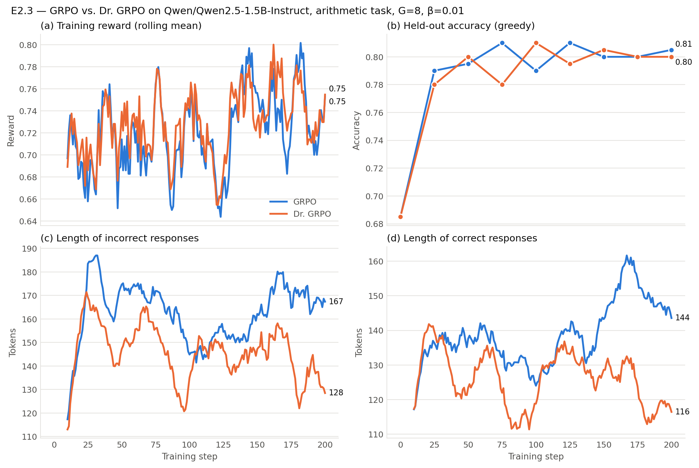

# E2.3 — GRPO by Hand: Results

| | |
|---|---|
| **Stage** | 2 — Reasoning Methods in Language Models |
| **Model** | `Qwen/Qwen2.5-1.5B-Instruct` + LoRA (r = 16, 18.5M trainable parameters, 1.2%) |
| **Task** | generated integer arithmetic, 4 operands ≤ 99 with `+ - *`; 2,000 train / 200 held-out problems |
| **Script** | [`e2_3_grpo_by_hand.py`](../e2_3_grpo_by_hand.py) — how it works: [E2.3 implementation](E2.3_grpo_implementation.md) |
| **Runs** | `e2_3_grpo_20261102_1624_log.jsonl` and `e2_3_dr_grpo_20261102_1827_log.jsonl`, 200 steps each, ~2 h each on an L4 |
| **Comparison** | `plot_e2_3.py` → `e2_3_compare_20261102_2027.png / .md` |
| **Status** | ✅ Success criterion met. The length effect is in the predicted direction but smaller and less specific than in the paper (§4) |

---

## 1. Success criterion (from the roadmap)

> *Implement GRPO in fewer than 200 lines on a toy verifiable task (arithmetic or string
> manipulation) with a small model. Then repeat with the Dr. GRPO correction.*
>
> **Success criterion:** *Training reward increases; you can articulate the length bias and
> show its effect in your own logs.*

| Part of the criterion | Evidence | Verdict |
|---|---|---|
| GRPO in < 200 lines, toy verifiable task, small model | 168 lines of code; exact-match reward on generated arithmetic; 1.5B model | ✅ |
| Repeated with the Dr. GRPO correction | Two runs differing only in `normalize_by_length` and `scale_by_std`, same seed and prompts | ✅ |
| Training reward increases | Held-out accuracy 68.5% → 80.5% (GRPO) / 80.0% (Dr. GRPO) on the same 200 problems; the Wilson intervals only touch at the edge. Training reward +6.6 / +5.0 pp (§3.1) | ✅ |
| Length bias articulated | Mechanism with worked numbers in [the implementation page](E2.3_grpo_implementation.md) (§3.6) and §4 below | ✅ |
| Length bias shown in own logs | Incorrect responses grow under GRPO (+22 tokens) and shrink under Dr. GRPO (−13 tokens). But correct responses move the same way, so the effect is a variant-level length drift rather than the clean "long wrong / short right" pattern (§4) | ✅ with caveat |

This also covers the Stage 2 gate-check item *"I have implemented GRPO myself and can explain
every term in the objective."*

## 2. Setup

Both runs use identical settings except for the two variant switches:

| | GRPO | Dr. GRPO |
|---|---|---|
| Advantage | (r − group mean) / group std | r − group mean |
| Per-response loss normalisation | ÷ its own length \|o_i\| | ÷ constant 256 (`max_new_tokens`) |
| Everything else | 200 steps × 8 prompts × 8 samples (12,800 samples), T = 0.9, lr 2·10⁻⁵, β = 0.01, ε = 0.2, μ = 1, seed 42 | same |

Sanity check: step 0 (held-out accuracy 68.5%) and step 1 (reward 0.453, same lengths) are
identical in both logs, confirming the same starting model, prompts and sampling seed.

## 3. Results

### 3.1 Reward and accuracy

**Held-out accuracy** (greedy, the same 200 problems at every checkpoint):

| Step | 0 | 25 | 50 | 75 | 100 | 125 | 150 | 175 | 200 |
|---|---:|---:|---:|---:|---:|---:|---:|---:|---:|
| GRPO | 68.5 | 79.0 | 79.5 | 81.0 | 79.0 | 81.0 | 80.0 | 80.0 | **80.5** |
| Dr. GRPO | 68.5 | 78.0 | 80.0 | 78.0 | 81.0 | 79.5 | 80.5 | 80.0 | **80.0** |

- Start: 137/200 = 68.5%, Wilson CI [61.8, 74.5].
- End: GRPO 161/200 = 80.5% [74.5, 85.4]; Dr. GRPO 160/200 = 80.0% [73.9, 85.0].
- **+12 pp for both variants, and the variants end within one problem of each other.** The
  start and end intervals only touch at the edge (74.5). The same 200 problems are scored every
  time, so a paired test would be more sensitive, but per-problem results are not logged (§6).

**Almost all of the gain happens in the first 25 steps**, then accuracy plateaus at 79–81%
for the remaining 175 steps. The checkpoint-to-checkpoint wobble (±1.5 pp = ±3 problems) is
noise.

**Training reward** (mean of 64 samples per step; first vs. last 25 steps): GRPO 0.684 → 0.750
(+6.6 pp), Dr. GRPO 0.693 → 0.743 (+5.0 pp). The per-step reward is noisy (panel a): its
range of 0.25–1.0 reflects how hard that step's 8 problems happen to be, not progress. The
held-out accuracy is the more reliable signal.

### 3.2 Response length

Mean tokens per response, training samples, first vs. last 25 steps:

| | GRPO start | GRPO end | Δ | Dr. GRPO start | Dr. GRPO end | Δ |
|---|---:|---:|---:|---:|---:|---:|
| Incorrect responses | 147.5 | 169.5 | **+22.0 (+15%)** | 144.1 | 131.3 | **−12.8 (−9%)** |
| Correct responses | 127.4 | 146.1 | +18.7 (+15%) | 130.6 | 115.8 | −14.8 (−11%) |
| Gap incorrect − correct | 20.1 | 23.4 | +3.3 | 13.5 | 15.5 | +2.0 |

Held-out (greedy) length of incorrect answers, steps 25–200: GRPO averages 173 tokens,
Dr. GRPO 166. At the last two checkpoints the difference is clearer: 177 vs. 152 and 164 vs.
153. Each checkpoint has only about 40 incorrect answers, so single checkpoints are noisy.

Overall, at the same accuracy, **Dr. GRPO's responses are shorter**: about 120 vs. 152 tokens
in the last 25 training steps (−21%), and 138 vs. 148 tokens on the held-out set at step 200
(−7%).

### 3.3 Training dynamics

| Metric (first / last 25 steps) | GRPO | Dr. GRPO |
|---|---:|---:|
| Zero-signal groups (all 8 samples score the same) | 0.45 → **0.72** | 0.43 → **0.67** |
| Truncated at 256 tokens | 6.7% → 1.5% | 2.9% → 0.6% |
| KL to reference | 0.011 → 0.012 | 0.004 → 0.012 |
| Gradient norm (typical) | 0.05–0.15 | 0.01–0.03 |

- **Most groups stop teaching anything.** By the end, about 70% of groups are all right or
  all wrong, so their advantages are zero. On 15 of the 400 steps (8 GRPO, 7 Dr. GRPO) *every*
  group was uniform and the update was KL-only. This is the main reason for the plateau (§5).
- **GRPO moves away from the reference faster at first** (KL 0.011 vs. 0.004 in the first
  25 steps), but both settle at 0.012. The KL penalty keeps the drift small throughout.
- **The 5× larger GRPO gradient norm does not mean 5× larger updates.** It comes from the std
  scaling (advantages up to ±2.5 instead of ±0.9) and the division by |o_i| ≈ 140 instead of
  256. AdamW normalises each parameter's update by its running gradient magnitude, and no
  gradient exceeded the clip of 1.0, so the step size is set by the learning rate in both runs.

## 4. Interpretation: the length bias

### 4.1 What the theory predicts

Under GRPO, each response's summed token loss is divided by its own length. A wrong answer
(negative advantage) is therefore penalised **less per token the longer it is**, and a correct
answer is rewarded **more per token the shorter it is**. Liu et al. (2025) predict, and
observe over long runs, that wrong answers grow longer while correct ones do not. Dr. GRPO
divides every response by the same constant, which removes this effect.

### 4.2 What the logs show

1. **Incorrect responses move in the predicted direction.** They grow under GRPO (+22 tokens)
   and shrink under Dr. GRPO (−13 tokens): a 35-token, 24% divergence from the same starting
   point. The held-out lengths at the last checkpoints point the same way.
2. **Correct responses move the same way, which the simple prediction does not expect.** Under
   GRPO they grow (+19) instead of shrinking. The gap between incorrect and correct lengths
   barely changes in either run (+3.3 vs. +2.0 tokens).

So what the logs mainly show is a **variant-level drift: GRPO makes all responses longer,
Dr. GRPO makes them shorter**, with the wrong-answer component in the predicted direction.

### 4.3 Why both kinds of answer move together

- **The same policy writes both.** A LoRA update that changes the writing style, for example
  writing out more intermediate products, lengthens right and wrong answers alike. In 200 steps
  the model cannot learn a separate length policy for answers it will get wrong.
- **Wrong answers are longer than right ones** (by 13–23 tokens in both the first and the last
  25 steps of both runs). Under GRPO, the long tail of the length distribution is mostly wrong answers, and
  those are exactly the responses penalised least per token, so the tail is allowed to grow.
  Under Dr. GRPO the total weight of a response grows with its length, so the same long wrong
  answers receive the largest total penalty, and the whole distribution shrinks.

### 4.4 How strong is the evidence?

| | Strength |
|---|---|
| Direction of the incorrect-length change (GRPO up, Dr. GRPO down) | consistent across training samples and the last two held-out checkpoints |
| Size | modest: 35 tokens of divergence after 200 steps |
| Specific to wrong answers | **no**: correct answers diverge by a similar amount |
| Replicated across seeds | **no**: one seed per variant |

The correct summary is: **the logs show the length effect in the direction the length bias
predicts, but 200 LoRA steps are too few to separate it from a general length drift.** The
practical consequence is clearer: Dr. GRPO reaches the same accuracy with shorter responses.

## 5. Interpretation: why accuracy plateaus after 25 steps

- **What the first 25 steps learn.** Held-out responses grow from 99 to ~150 tokens in that
  window for *both* variants, correct ones included (103 → 138–146), while accuracy rises 11 pp.
  The likely explanation is that the model learns to write out intermediate results instead of
  shortcutting multi-digit multiplication. This is a hypothesis; reading samples from the step-0
  and step-25 models would confirm it.
- **Then the learning signal dries up.** As the model improves, more groups are all correct;
  the hardest problems (three chained 2-digit multiplications, answers in the millions) stay
  all wrong. Either way the advantage is zero, and by the end about 70% of each batch carries no
  gradient. Fixes from the literature include **dynamic sampling** (DAPO: drop or resample
  zero-variance groups), a curriculum that keeps problems near 50% difficulty, or larger groups.

## 6. Limitations

- **One seed per variant.** The length divergence and the ±1.5 pp accuracy differences have no
  variance estimate. Stage 4 (E4.2) asks for three seeds; the same applies here before citing
  the length result.
- **Short training.** 200 steps of LoRA training; the length bias in Liu et al. builds up over
  far longer runs.
- **Both switches changed at once.** The length effect cannot be attributed to
  `normalize_by_length` alone; `scale_by_std` also changes the per-sample weighting. Running
  the two switches separately would isolate it.
- **β = 0.01 in both variants.** Liu et al. also drop the KL term in Dr. GRPO; this run keeps it
  to isolate the normalisation, so "Dr. GRPO" here is not exactly the paper's recipe.
- **Held-out accuracy is logged in aggregate only**, so no paired test between variants or
  checkpoints is possible. Logging per-problem correctness would allow McNemar tests as in E2.1.

## 7. What this result feeds into

- **Stage 4 (RL on a VLM):** use the Dr. GRPO normalisation by default (same accuracy, shorter
  responses, no length incentive), plan for zero-signal groups from the start (dynamic
  sampling), and run at least three seeds.
- **E4.5 (overthinking audit):** the length drift here, with response length rising while
  accuracy stays flat, is a small text-only version of the overthinking pattern that audit
  looks for.
- **Possible follow-ups (cheap, same script):**
  1. 600+ steps per variant, to see whether the incorrect–correct gap opens under GRPO.
  2. The two switches separately (`normalize_by_length` only, `scale_by_std` only).
  3. Two more seeds per variant.
  4. Log per-problem held-out correctness for paired tests.
