# E2.3 — Flow Chart: The Training Loop

```mermaid
flowchart TD
    START(["Start: --variant grpo or dr_grpo"]) --> CONF["Read config<br/>set NORM_LEN, SCALE_STD from variant"]
    CONF --> PROB["Generate eval set, then train set<br/>disjoint, fixed seeds"]
    PROB --> LOAD["Load Qwen2.5-1.5B-Instruct<br/>enable gradient checkpointing<br/>attach LoRA adapter"]
    LOAD --> EV0["Step 0: greedy evaluation<br/>log baseline accuracy and lengths"]
    EV0 --> PICK

    subgraph LOOP["for step = 1 … steps (600)"]
        PICK["Pick next 5 training prompts<br/>shuffled order, cycles if needed"] --> ROLL["Rollout: generate 8 samples per prompt<br/>40 completions, ≤ 256 tokens"]
        ROLL --> MASK["Build completion mask<br/>tokens up to and including first EOS"]
        MASK --> REW["Reward per completion<br/>extract answer, compare exactly"]
        REW --> ADV["A = r − mean of its group of 8"]
        ADV --> STD{"scale_by_std?"}
        STD -->|"yes: GRPO"| DIV["A = A ÷ (std of group + 1e-4)"]
        STD -->|"no: Dr. GRPO"| BETA
        DIV --> BETA{"kl_coef β > 0?"}
        BETA -->|yes| REFLP["Reference log-probs<br/>adapter disabled, no grad"]
        BETA -->|no| MU
        REFLP --> MU{"ppo_epochs μ > 1?"}
        MU -->|yes| OLD["Old-policy log-probs<br/>no grad, frozen for all μ epochs"]
        MU -->|"no (default)"| TRAINMODE
        OLD --> TRAINMODE["model.train(), zero gradients"]
        TRAINMODE --> MB["Next micro-batch of 8 sequences"]
        MB --> LOGP["Policy log-probs with gradient"]
        LOGP --> RATIO["ratio ρ = exp(log π_θ − log π_old)"]
        RATIO --> CLIP["per-token loss = −min(ρA, clip(ρ, 0.8, 1.2)·A)"]
        CLIP --> KL["+ β · KL_k3 to reference"]
        KL --> NORM{"normalize_by_length?"}
        NORM -->|"yes: GRPO"| L1["Σ_t loss ÷ length of o_i per response,<br/>then ÷ N = 40"]
        NORM -->|"no: Dr. GRPO"| L2["Σ over all tokens ÷ (N × 256)"]
        L1 --> BACK["loss.backward()<br/>gradients accumulate"]
        L2 --> BACK
        BACK --> MORE{"more micro-batches?"}
        MORE -->|yes| MB
        MORE -->|no| UPD["Clip grad norm to 1.0<br/>AdamW step on LoRA weights"]
        UPD --> EVQ{"step % 25 == 0<br/>or last step?"}
        EVQ -->|yes| EVAL["Greedy evaluation on 100 held-out problems"]
        EVQ -->|no| WRITE
        EVAL --> WRITE["Append row to log JSONL<br/>print progress line"]
        WRITE --> NEXT{"step < steps?"}
        NEXT -->|yes| PICK
    end

    NEXT -->|no| SAVE["Save LoRA adapter"] --> DONE(["Done: run plot_e2_3.py"])
```

With the default `ppo_epochs: 1`, the "for each epoch" loop runs once, so the flow is:
one rollout → one gradient step. With μ > 1 the same rollouts would be reused for μ updates,
which is where the old-policy log-probs and clipping start to matter (§3.4 of the
implementation page).

← Back to [E2.3 implementation](E2.3_grpo_implementation.md)
