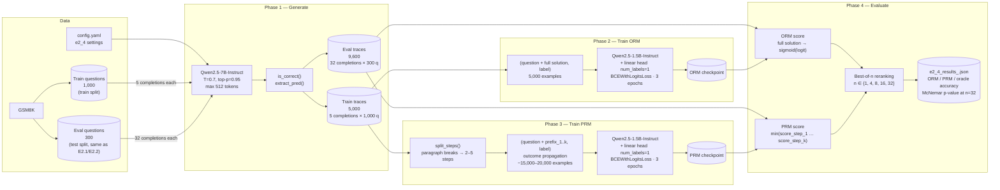

# E2.4 — Block Diagram: Components and Data Flow

Key points:

- **ORM and PRM share the same backbone and architecture** (`Qwen2.5-1.5B-Instruct` +
  `AutoModelForSequenceClassification` with `num_labels=1`), but are trained independently
  on different views of the same traces. ORM sees the full solution once per trace; PRM
  sees every step prefix — 3–5× more training examples from the same 5,000 traces.

- **Outcome propagation** is the step label strategy: a step prefix in a *correct*
  solution receives label 1; a step prefix in an *incorrect* solution receives label 0.
  This avoids per-step human annotations at the cost of assigning label 0 to any correct
  reasoning that happens to precede a final arithmetic error.

- **PRM pessimistic aggregation:** at eval time, all step prefixes for a solution are
  scored in a single batched forward pass, and the minimum step score is returned. The
  weakest step governs: a single bad step disqualifies the whole solution.

- **Same 300 questions as E2.1 / E2.2.** `select_subset(test_all, 300, seed=42)` is the
  same call used in every Stage 2 experiment, so best-of-32 accuracy is directly
  comparable with the oracle ceiling from E2.2 (98.0% any-correct at k=32).

- **Phases are independent.** Each phase writes its output to disk and exits. If a session
  disconnects after `generate`, the traces JSONL survives and the RM training phases can be
  run on a fresh session by passing `--traces_file` explicitly.

← Back to [E2.4 Verifier Study](E2.4_verifier_study.md)
