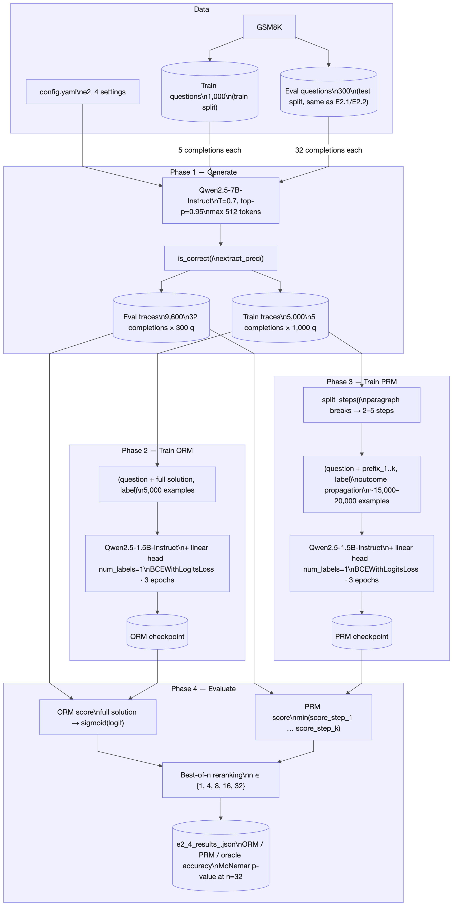

# E2.4 — Verifier Study: Outcome RM vs. Process RM

Stage 2, Experiment 2.4 · Multimodal Reasoning Thesis Roadmap

**Paper**: Lightman et al. (2023), *Let's Verify Step by Step*, arXiv:2305.20050

---

## Success criterion

> Process supervision outperforms outcome supervision at matched *n*, replicating the
> qualitative finding of Lightman et al. (2023).

---

## 1. Block diagram: components and data flow



*Mermaid source: [E2.4_verifier_block_diagram.md](E2.4_verifier_block_diagram.md)*

Key points:

- **Four sequential phases**, each writing output to disk so a disconnected session can
  resume from the last completed phase via `--traces_file`, `--orm_path`, `--prm_path`.
- **One generator, two verifiers.** `Qwen2.5-7B-Instruct` produces all completions once;
  the ORM and PRM are trained independently on different views of those same traces.
- **ORM vs. PRM training data:** ORM gets one (question, full solution) pair per trace
  (5,000 examples); PRM gets one pair per *step prefix* (~15,000–20,000 examples), all
  labelled by the final answer correctness (outcome propagation).
- **Same eval questions as E2.1 / E2.2.** `select_subset(test, 300, seed=42)` is the
  identical call, so the oracle ceiling from E2.2 (98.0% any-correct at k=32) is a
  direct upper bound for E2.4's best-of-32 curves.

---

## 2. What are verifiers and why compare them?

A **verifier** (reward model) scores a candidate solution to decide whether it is worth
keeping. In best-of-*n* reranking, a generator produces *n* solutions and the verifier
selects the one it rates highest; accuracy is then measured on the selected solutions.

Two families:

| | Outcome RM (ORM) | Process RM (PRM) |
|---|---|---|
| **Input** | Question + full solution | Question + partial solution (up to step *k*) |
| **Label** | 1 if final answer correct, else 0 | 1 at each step of a correct solution, else 0 |
| **Score** | Scalar for the whole solution | One scalar per step; aggregate by min |
| **Training data** | Easy — just check the final answer | Hard — requires per-step human labels (*PRM800K*) or approximations |

The E2.4 PRM uses **outcome propagation** as its step label strategy: every step in a
correct solution receives label 1, every step in an incorrect one receives label 0. This
is a cheap approximation that avoids human annotation at the cost of labelling the first
wrong step (and all steps before it) in an incorrect solution as negative, even if those
steps were themselves correct.

---

## 3. Setup

### 3.1 Generator

| Setting | Value |
|---|---|
| Model | `Qwen/Qwen2.5-7B-Instruct` (same as E2.1 / E2.2) |
| Prompt | Zero-shot CoT: *"Think step by step, then state the final answer as: 'The answer is <number>.'"* |
| Sampling | temperature 0.7, top-p 0.95, max 512 tokens |
| Train traces | 5 completions × 1,000 GSM8K **train** questions = 5,000 traces |
| Eval traces | 32 completions × 300 GSM8K **test** questions (same 300 as E2.1 / E2.2) |

Accuracy check at generation time uses `extract_pred` / `is_correct` from `reasoning_utils.py`
(the same extraction logic as every other Stage 2 experiment).

### 3.2 Reward models

| Setting | ORM | PRM |
|---|---|---|
| Backbone | `Qwen/Qwen2.5-1.5B-Instruct` | Same |
| Architecture | `AutoModelForSequenceClassification`, `num_labels=1` | Same |
| Input | `"Question: {q}\n\nSolution: {full_sol}"` | `"Question: {q}\n\nSolution: {steps_1..k}"` |
| Max seq len | 512 | 1,024 |
| Loss | `BCEWithLogitsLoss` | Same |
| Epochs | 3 | 3 |
| LR | 2 × 10⁻⁵ | 2 × 10⁻⁵ |
| Batch size | 16 | 8 |
| Label | 1 if answer correct, else 0 | Same (outcome propagation per step) |
| Training examples | 5,000 (one per trace; 94.7% pos) | 29,853 (one per step prefix, ~6 steps/trace on average; 94.2% pos) |

### 3.3 Step splitting

The PRM splits each solution on `\n\n` (paragraph breaks). If fewer than two paragraphs
are found it falls back to `\n`. This gives 2–5 steps for typical Qwen2.5-7B CoT
solutions. The PRM is trained on each prefix independently.

### 3.4 PRM score aggregation

At evaluation time, each solution is scored by running the PRM on every step prefix
and taking the **minimum** step score. Pessimistic aggregation reflects the idea that a
single wrong step makes the entire solution unreliable — a weaker but easier-to-implement
analogue of the Lightman et al. finding that the min is better than the mean.

### 3.5 Best-of-*n* protocol

For each *n* ∈ {1, 4, 8, 16, 32}:

1. Take the first *n* of the 32 pre-generated completions.
2. Score all *n* with the ORM (or PRM).
3. Return the solution with the highest score.
4. Compare to: *k = 1 baseline* (single sample, no reranking) and *oracle* (any
   correct solution among the *n*).

The k = 1 baseline is a flat line — a single random sample's accuracy. Everything above
it is a gain from reranking.

---

## 4. Code

| File | Purpose |
|---|---|
| [`e2_4_verifier_study.py`](../e2_4_verifier_study.py) | Main script: generate → train ORM → train PRM → evaluate |
| [`config.yaml`](../config.yaml) | `e2_4` section: dataset, n_train_traces, best_of_n_values, rm training settings |
| [`reasoning_utils.py`](../reasoning_utils.py) | `extract_pred`, `is_correct`, `select_subset`, `paired_compare` |

```bash
# Full run (all phases in sequence)
python e2_4_verifier_study.py --phase all

# Or phase by phase (useful after a disconnect)
python e2_4_verifier_study.py --phase generate
python e2_4_verifier_study.py --phase train_orm --traces_file outputs/e2_4_traces_STEM.jsonl
python e2_4_verifier_study.py --phase train_prm  --traces_file outputs/e2_4_traces_STEM.jsonl
python e2_4_verifier_study.py --phase evaluate \
    --traces_file outputs/e2_4_traces_STEM.jsonl \
    --orm_path outputs/e2_4_orm_STEM \
    --prm_path outputs/e2_4_prm_STEM

# Smoke test (20 questions per split, 4 completions)
python e2_4_verifier_study.py --phase all --n_smoke 20
```

Outputs:

| File | Contents |
|---|---|
| `e2_4_traces_<stem>.jsonl` | One JSON record per completion: `{split, question, gt, text, correct}` |
| `e2_4_orm_<stem>/` | Fine-tuned ORM checkpoint (`AutoModelForSequenceClassification`) |
| `e2_4_prm_<stem>/` | Fine-tuned PRM checkpoint |
| `e2_4_results_<stem>.json` | Best-of-n accuracy table + McNemar p-value |

---

## 5. Why outcome propagation under-labels the PRM

A solution that is *almost correct* (gets the right setup but makes an arithmetic error
in the last step) will have all its step prefixes labelled 0. The model is trained to
assign low scores to reasoning it has never seen labelled positively. This creates a
systematic labelling error:

```
Solution (incorrect final answer):
  Step 1: "She earns $5 × 3 = $15 per hour."     → labelled 0
  Step 2: "She works 8 hours, so 15 × 8 = $130."  → labelled 0  (error here)
  Step 3: "The answer is 130."                     → labelled 0
```

Under human (Lightman et al.) labels, Step 1 would be labelled 1 and Step 2 would be
labelled 0. Outcome propagation labels them both 0. The PRM therefore learns to distrust
correct reasoning that happens to precede an error. This is the principal motivation for
collecting expensive per-step human annotations (PRM800K), and the reason process
supervision is *harder to obtain for images* (there are no process annotations for
visual reasoning chains).

---

## 6. Results

Full results: **[E2.4_verifier_results.md](E2.4_verifier_results.md)**

Key numbers (266 eval questions, 32 completions each):

| n | k=1 baseline | ORM | PRM | Oracle |
|---:|---:|---:|---:|---:|
| 1 | 88.72% | 88.72% | 88.72% | 88.72% |
| 8 | 88.72% | **90.60%** | 89.85% | 96.99% |
| 16 | 88.72% | 89.85% | **90.98%** | **98.12%** |
| 32 | 88.72% | 89.10% | **90.98%** | **98.12%** |

**ORM overoptimises**: peaks at n = 8 (90.60%), degrades to 89.10% by n = 32 (−1.50 pp).  
**PRM is robust**: improves monotonically to n = 16, then plateaus at 90.98%.  
**McNemar p = 0.38** (13 PRM-only vs 8 ORM-only correct) — qualitative finding replicated, not statistically significant at this scale.  
**Majority voting (E2.2 at k=32: 93.3%) beats both RMs** — ensemble agreement outperforms outcome-propagation classifiers.

---

## 7. Connection to multimodal reasoning

The limitation identified in §5 becomes acute for multimodal reasoning:

- **Text**: human annotators can verify arithmetic and algebra step-by-step.
- **Images**: there is no equivalent to PRM800K for visual reasoning chains. It is
  unclear how to even define a "step" in a diagram-understanding task.

Outcome propagation (which only needs the final answer) is therefore the only currently
scalable PRM training signal for vision. E2.4 measures how much accuracy it trades away
versus a perfect step-level signal — a gap that motivates Stage 3's exploration of
automatic step-verification proxies (geometry solvers, executable programs).
